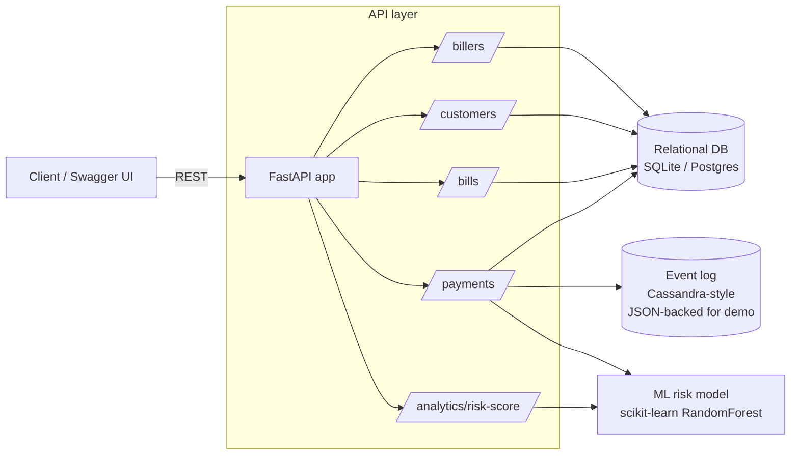

# Architecture

## Data stores

**Relational (SQL)** — `app/models.py`
- `billers`, `customers`, `bills`, `transactions`
- Normalised, indexed on the columns the API actually filters by
  (`biller.category`, `bill.customer_id + status`), matching the "query
  optimisation" bullet in the JD.

**Event log (NoSQL-style)** — `app/nosql_store.py`
- Append-only, partitioned by `customer_id`, clustered by `event_time`.
- Chosen to mirror how you would model the same log in **Apache Cassandra**:
  wide, denormalised, optimised for "give me this customer's recent events"
  rather than ad-hoc joins.
- Implemented with a JSON file here purely so the demo has no external
  services to install; swapping in `cassandra-driver` and the CQL table in
  the docstring of `nosql_store.py` would be a drop-in replacement in a real
  deployment.

## ML risk scoring

- `app/ml/train_model.py` generates a synthetic but realistic dataset
  (bigger amounts, odd hours, repeat-failure customers => higher failure
  probability) and trains a `RandomForestClassifier`.
- `app/ml/predict.py` loads the trained model and exposes `score_transaction`.
- Used two ways:
  1. Inline, during `/payments/` — every payment gets a `risk_score` before
     it's simulated as success/failure.
  2. Standalone, via `/analytics/risk-score` — score a hypothetical
     transaction without touching the database.

## Testing strategy

- **Unit / integration** (`tests/`, pytest + FastAPI `TestClient`): each test
  gets an isolated SQLite file and an isolated event-log file, so tests
  never leak state into each other.
- **ML tests** (`tests/test_ml.py`): sanity-check the model's output range
  and monotonicity (more past failures => higher or equal risk).
- **API-level smoke testing** (`postman_collection.json`): a ready-made
  Postman collection covering the full biller -> customer -> bill -> payment
  -> risk-score flow, for manual/exploratory testing.
- **UI automation** (`selenium_test.py`): a minimal Selenium check against
  the bill-lookup page, included to demonstrate automation-testing
  familiarity (kept out of CI since it needs a real browser/driver).

## What would change for a production version

- Swap SQLite for Postgres (`DATABASE_URL` env var already supports this)
  and add Alembic migrations instead of `create_all`.
- Swap the JSON event log for a real Cassandra (or DynamoDB) table using the
  schema already documented in `nosql_store.py`.
- Replace the simulated gateway call in `payments.py` with a real payment
  gateway integration, and retrain the ML model on real transaction history
  on a schedule rather than synthetic data.
- Add auth (OAuth2/JWT) in front of the API — deliberately left out here to
  keep the demo focused.
